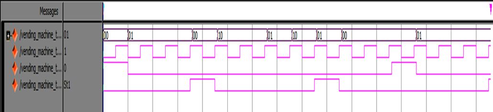

# Vending Machine FSM (Moore)

> **Topic 04: Finite State Machine** · Author: Anushka Gope

## Purpose

Models a milk vending machine as a finite state machine that accepts coins and dispenses when 15 units have been inserted.

## Working Principle

Moore machine with four states `s0` (0), `s5` (5), `s10` (10), `s15` (15) holding the amount inserted so far. The 2-bit `coin` input is `00` none, `01` 5-unit coin and `10` 10-unit coin; `11` leaves the state unchanged. Output `milk` is high only in `s15`, and `s15` always returns to `s0` on the next clock. The code comments mark four fixes the author applied (nonblocking assignments, a 2-bit constant, covering `coin == 2'b11`, and the output decode). The testbench uses an `insert_coin` task to run five scenarios.

## Interface

### Inputs

| Port | Width | Description |
|---|---|---|
| `clk` | 1 | Clock |
| `rst` | 1 | Asynchronous reset (active high) |
| `coin` | 2 | Coin code |

### Outputs

| Port | Width | Description |
|---|---|---|
| `milk` | 1 | Dispense signal (reg) |

## Source Files

| Type | File | Top module | Origin |
|---|---|---|---|
| Design | [`vending_machine.v`](vending_machine.v) | `vending_machine` | Original |
| Testbench | [`vending_machine_tb.v`](vending_machine_tb.v) | `vending_machine_tb` | Original |

## Simulation Results

**ModelSim waveform of the vending-machine testbench (signal names truncated in the screenshot)**



The waveform shows the state value, clock, coin and milk traces. Signal names are truncated in the screenshot, so the traces are identified only by their order.

See [`Simulation-Results/README.md`](Simulation-Results/README.md) for details.

## Known Issues and Resolutions

Original code is preserved exactly (in `Original-Source/` where a file was replaced). Problems are documented rather than silently corrected.

- The source code had lost its line breaks (several statements and comments ran together on single lines). Line breaks were restored without changing any token; a whitespace-insensitive comparison against the source confirmed this.

All issues are collected in [`Known-Issues.md`](../../Known-Issues.md).

## Running the Simulation

**Compile status (static review):** Compiles on its own by static reading.

```bash
# Example with Icarus Verilog (indicative; not executed while preparing this repository)
iverilog -o sim vending_machine.v vending_machine_tb.v
vvp sim
```

The original results were produced with the tools used in the lab (ModelSim-style waveform windows and Synopsys / Xilinx report formats appear in the source). No simulation was re-run while preparing this portfolio.
