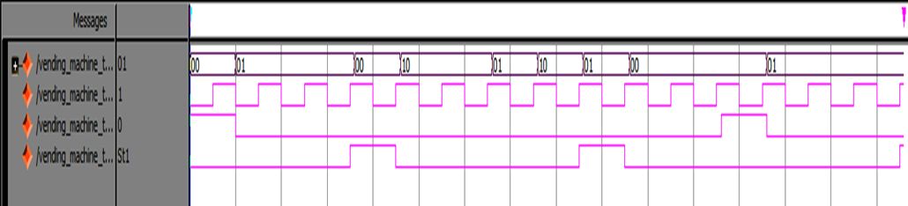

# Simulation Results: Vending Machine FSM (Moore)

> Topic 04: Finite State Machine · Author: Anushka Gope

The images below were extracted from the original lab documents. They are genuine captures, not regenerated.

### `waveform.png`

ModelSim waveform of the vending-machine testbench (signal names truncated in the screenshot).

## What the images show

The waveform shows the state value, clock, coin and milk traces. Signal names are truncated in the screenshot, so the traces are identified only by their order.

## Not provided in the source

- `simulation-output.png` (console / transcript output): the source documents contain no console captures, so this file has intentionally not been created.

## Notes

- The source code had lost its line breaks (several statements and comments ran together on single lines). Line breaks were restored without changing any token; a whitespace-insensitive comparison against the source confirmed this.
