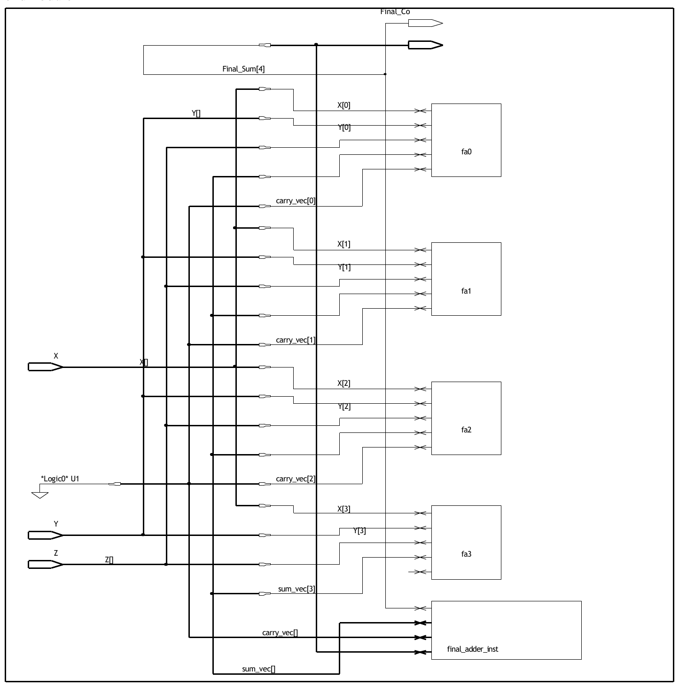

# 4-bit Carry Save Adder

> **Topic 06: Design of Subsystems** · Author: Anushka Gope

## Purpose

Adds three 4-bit numbers using a carry-save stage followed by a conventional adder.

## Working Principle

Four full adders (`fa0`..`fa3`) each add one bit position of X, Y and Z, producing a sum vector and a carry vector without propagating carries. The carry vector is shifted left by one position and added to the sum vector with the `+` operator, giving a 6-bit result (the largest possible sum is 15 + 15 + 15 = 45). `Final_Co` repeats `Final_Sum[5]`.

**Original versus corrected.** The original (kept unchanged in [`Original-Source/`](Original-Source/)) produced a 5-bit `Final_Sum`, left `carry_vec[3]` unused and used a `ripple_adder` instance as the final adder. The corrected version widens the result to 6 bits, uses `carry_vec[3]` and replaces the instance by `+`. It is a newly written replacement, so the original behaviour is not reproduced bit for bit.

## Interface

### Inputs

| Port | Width | Description |
|---|---|---|
| `X` | 4 | Operand X |
| `Y` | 4 | Operand Y |
| `Z` | 4 | Operand Z |

### Outputs

| Port | Width | Description |
|---|---|---|
| `Final_Sum` | 6 | Sum of X, Y and Z (corrected version) |
| `Final_Co` | 1 | Copy of Final_Sum[5] |

## Source Files

**Origin key.** *Original*: extracted from the lab documents (formatting only). *Corrected (new)* and *Added (new)*: newly prepared files merged in later; they are not recovered originals and have not been simulated. *Added (reference implementation)*: newly written to stand in for missing source.

| Role | File | Top module | Origin | Note |
|---|---|---|---|---|
| Design | [`carry_save_adder_4bit.v`](carry_save_adder_4bit.v) | `carry_save_adder_4bit` | Corrected (new) | 6-bit result; replaces the original 5-bit version |
| Testbench | [`carry_save_adder_4bit_tb.v`](carry_save_adder_4bit_tb.v) | `carry_save_adder_4bit_tb` | Corrected (new) | Exhaustive 16 x 16 x 16 comparison; not simulated |
| Dependency | [`fulladder.v`](fulladder.v) | `fulladder` | Added (new) | The missing 1-bit full adder |

**Original files, kept unchanged** in [`Original-Source/`](Original-Source/) (see its [README](Original-Source/README.md)):

| Role | File | Top module | Why it is not the main file |
|---|---|---|---|
| Design | [`Original-Source/carry_save_adder_4bit.v`](Original-Source/carry_save_adder_4bit.v) | `carry_save_adder_4bit` | Needs `fulladder` and `ripple_adder` |
| Testbench | [`Original-Source/carry_save_adder_4bit_tb.v`](Original-Source/carry_save_adder_4bit_tb.v) | `tb_carry_save_adder_4bit` | Uses `$fsdbDumpvars` |

## Simulation Results

**RTL schematic supplied in the source (page extracted as an image)**



No simulation waveform was supplied for either version. The supplied RTL schematic (above) shows the **original** structure, with `fa0`..`fa3` and a `final_adder_inst` block and a 5-bit `Final_Sum`, so it does **not** match the corrected design, which has no such block.

**Added testbench (`carry_save_adder_4bit_tb.v`).** It applies all 16 x 16 x 16 = 4096 combinations of X, Y and Z and prints a `FAIL` line whenever `Final_Sum` differs from `X + Y + Z`. It prints nothing for a passing case, so an empty console would be the expected result of a clean run. Not simulated: no simulator was available, so no pass/fail result is claimed for the added files.

See [`Simulation-Results/README.md`](Simulation-Results/README.md) for details.

## Known Issues and Resolutions

Original code is preserved exactly (in `Original-Source/` where a file was replaced). Problems are documented rather than silently corrected.

**Resolved by the added / corrected files**

- Missing module: `fulladder.v` was added (newly written; ports `X, Y, Ci, S, Co` match every instantiation in the original code).
- Result width: the corrected design has a 6-bit `Final_Sum` and uses `carry_vec[3]`.
- Testbench: a new exhaustive testbench replaces the original, which is kept in `Original-Source/`.

**Still open or worth knowing**

- The corrected design is a replacement: width 5 -> 6 bits, `ripple_adder` instance -> `+` operator. Do not compile it together with the original file (both define `carry_save_adder_4bit`).
- By inspection, the original drops `carry_vec[3]` and cannot represent sums above 31. It is preserved in `Original-Source/` for traceability only.
- The RTL schematic belongs to the original structure.

All issues are collected in [`Known-Issues.md`](../../Known-Issues.md).

## Running the Simulation

**Compile status (static review):** Static port/name check of `fulladder.v`, `carry_save_adder_4bit.v` and `carry_save_adder_4bit_tb.v`: no problems found. The files in `Original-Source/` additionally need `fulladder.v` and `../02-4bit-Ripple-Carry-Adder/ripple_adder.v`.

```bash
# Example with Icarus Verilog (indicative; not executed while preparing this repository)
iverilog -o sim fulladder.v carry_save_adder_4bit.v carry_save_adder_4bit_tb.v
vvp sim
```

Do not mix the files in `Original-Source/` with the main files: several of them define the same module names.

The original results were produced with the tools used in the lab (ModelSim-style waveform windows and Synopsys / Xilinx report formats appear in the source). No simulation was re-run while preparing this portfolio.
