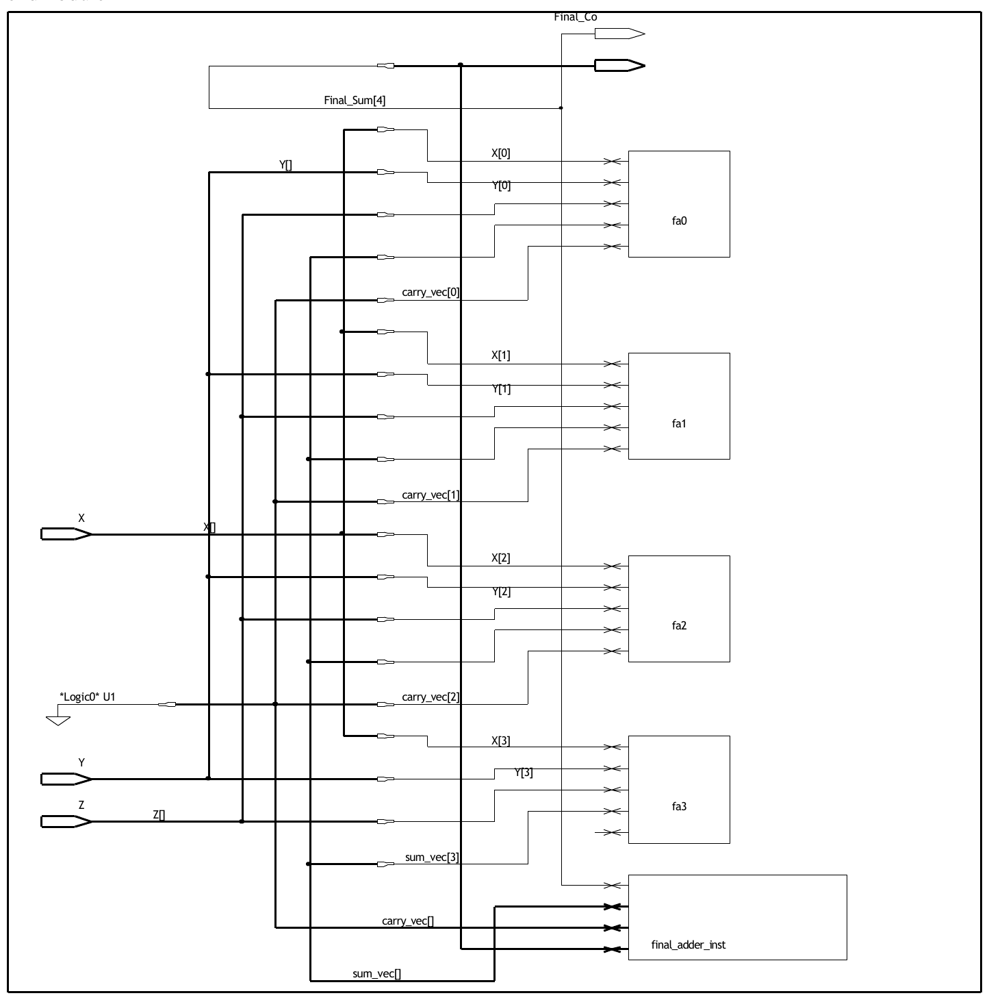

# Simulation Results: 4-bit Carry Save Adder

> Topic 06: Design of Subsystems · Author: Anushka Gope

The images below were extracted from the original lab documents. They are genuine captures, not regenerated.

### `schematic.png`

RTL schematic supplied in the source (page extracted as an image).

## What the images show

No simulation waveform was supplied for either version. The supplied RTL schematic (above) shows the **original** structure, with `fa0`..`fa3` and a `final_adder_inst` block and a 5-bit `Final_Sum`, so it does **not** match the corrected design, which has no such block.

**Added testbench (`carry_save_adder_4bit_tb.v`).** It applies all 16 x 16 x 16 = 4096 combinations of X, Y and Z and prints a `FAIL` line whenever `Final_Sum` differs from `X + Y + Z`. It prints nothing for a passing case, so an empty console would be the expected result of a clean run. Not simulated: no simulator was available, so no pass/fail result is claimed for the added files.

## Not provided in the source

- `simulation-output.png` (console / transcript output): the source documents contain no console captures, so this file has intentionally not been created.

## Notes

- The corrected design is a replacement: width 5 -> 6 bits, `ripple_adder` instance -> `+` operator. Do not compile it together with the original file (both define `carry_save_adder_4bit`).
- By inspection, the original drops `carry_vec[3]` and cannot represent sums above 31. It is preserved in `Original-Source/` for traceability only.
- The RTL schematic belongs to the original structure.
