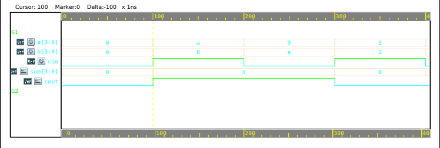
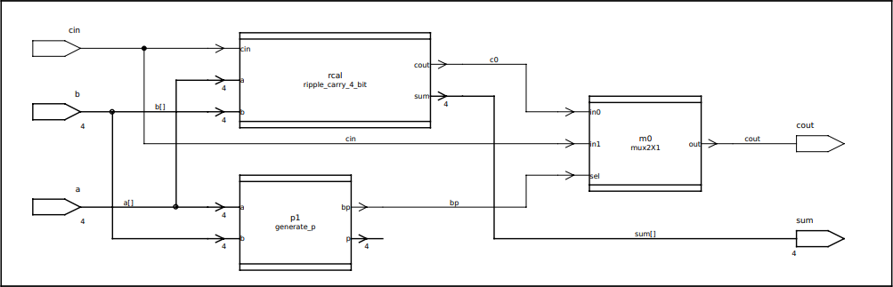

# 4-bit Carry Skip Adder

> **Topic 07: Carry Skip Adder** · Author: Anushka Gope

## Purpose

Implements a 4-bit carry skip adder, which speeds up carry propagation by letting the carry bypass the ripple chain when every bit position propagates.

## Working Principle

A ripple-carry adder produces `Sum`, a ripple carry-out and the per-bit propagate vector `P`. The block propagate signal is `P[0] & P[1] & P[2] & P[3]`. A 2:1 multiplexer chooses `Cout`: if the block propagates, the carry-in skips straight to `Cout`; otherwise the ripple carry-out is used. The top-level module is named `csa` in the source (not to be confused with a carry-save adder).

## Interface

### Inputs

| Port | Width | Description |
|---|---|---|
| `A` | 4 | Operand A |
| `B` | 4 | Operand B |
| `Cin` | 1 | Carry in |

### Outputs

| Port | Width | Description |
|---|---|---|
| `Sum` | 4 | Sum |
| `Cout` | 1 | Carry out |

## Source Files

**Origin key.** *Original*: extracted from the lab documents (formatting only). *Corrected (new)* and *Added (new)*: newly prepared files merged in later; they are not recovered originals and have not been simulated. *Added (reference implementation)*: newly written to stand in for missing source.

| Role | File | Top module | Origin | Note |
|---|---|---|---|---|
| Design | [`carry_skip_adder.v`](carry_skip_adder.v) | `csa` | Corrected (new) | Same structure as the original; `Endmodule` typo removed |
| Testbench | [`carry_skip_adder_tb.v`](carry_skip_adder_tb.v) | `carry_skip_adder_tb` | Corrected (new) | Exhaustive 16 x 16 x 2 comparison; not simulated |
| Dependency | [`rca.v`](rca.v) | `rca` | Added (new) | The missing ripple-carry adder with propagate output |
| Dependency | [`mux_2to1.v`](mux_2to1.v) | `mux_2to1` | Added (new) | The missing 2:1 multiplexer |

**Original files, kept unchanged** in [`Original-Source/`](Original-Source/) (see its [README](Original-Source/README.md)):

| Role | File | Top module | Why it is not the main file |
|---|---|---|---|
| Design | [`Original-Source/carry_skip_adder.v`](Original-Source/carry_skip_adder.v) | `csa` | Ends with `Endmodule`; needs `rca` and `mux_2to1` |
| Testbench | [`Original-Source/carry_skip_adder_tb.v`](Original-Source/carry_skip_adder_tb.v) | `csa_tb` | Loops cover 264 cases, not 256 or 512 |

**Synthesis / tool reports**

- [`Synthesis-Reports/carry-skip-area-power-reports.md`](Synthesis-Reports/carry-skip-area-power-reports.md): Area and power report of the carry skip adder (main lab)
- [`Synthesis-Reports/postlab-carry-save-vs-carry-skip.md`](Synthesis-Reports/postlab-carry-save-vs-carry-skip.md): Post-lab area, delay and power reports (carry save adder and carry skip adder)
- [`Synthesis-Reports/postlab-expected-comparison.md`](Synthesis-Reports/postlab-expected-comparison.md): Source "Expected Comparison" table (inconsistent with the actual reports)

## Simulation Results

**Waveform supplied in the source (signal names differ from the supplied testbench)**



**Schematic supplied in the source (module names differ from the supplied code)**



Waveform supplied in the source, with values read from the image:

| A | B | Cin | Sum | Cout |
|---|---|---|---|---|
| 0 | 0 | 0 | 0 | 0 |
| a | 8 | 1 | 3 | 1 |
| 9 | a | 0 | 3 | 1 |
| 5 | 2 | 1 | 8 | 0 |

Values are hexadecimal. They are consistent with 4-bit addition. The waveform uses lower-case signal names (`a`, `b`, `cin`, `sum`, `cout`) and a stimulus that does not match the supplied testbench, so it was evidently produced by a different testbench.

Area, delay and power reports are in [`Synthesis-Reports/`](Synthesis-Reports/). Key figures from the carry skip report: 14 I/Os, 25 BELS (10 AND2, 1 AND4, 1 INV, 5 OR2, 8 XOR2), 14 I/O buffers, estimated power 37.800 uW at 1.80 V, and a longest pad-to-pad delay of 13.400 ns.

**Provenance of the reports and images.** The waveform, schematic and reports come from the lab's own modules, which are not the files added later. The added `rca.v` and `mux_2to1.v` are new and are not claimed to be identical to the modules behind those images and reports.

**Corrected testbench (`carry_skip_adder_tb.v`).** It applies all 16 x 16 x 2 = 512 combinations of A, B and Cin and prints a `FAIL` line whenever `{Cout, Sum}` differs from `A + B + Cin`. It prints nothing for a passing case. Not simulated: no simulator was available, so no pass/fail result is claimed for the added files.

See [`Simulation-Results/README.md`](Simulation-Results/README.md) for details.

## Known Issues and Resolutions

Original code is preserved exactly (in `Original-Source/` where a file was replaced). Problems are documented rather than silently corrected.

**Resolved by the added / corrected files**

- Missing modules: `rca.v` (4-bit ripple carry adder with a propagate output `P`) and `mux_2to1.v` were added (newly written).
- Typo: the corrected top module ends with `endmodule`; the original ended with `Endmodule`.
- Coverage: the new testbench is exhaustive; the original loops covered 264 cases while its comment claimed 256.

**Still open or worth knowing**

- The supplied schematic shows different module names (`ripple_carry_4_bit`, `generate_p`, `mux2X1`) from the code.
- The supplied waveform uses lower-case signal names and a stimulus that does not match either testbench.
- The post-lab "Expected Comparison" table does not agree with the actual reports (for example 40 and 42 BELs versus 100 and 25). See the post-lab files in `Synthesis-Reports/`.
- The corrected top module has the same ports and instances as the original. A token comparison shows three differences only: grouped input declaration (`input [3:0] A, B`), `&P` instead of `P[0] & P[1] & P[2] & P[3]`, and `endmodule` instead of `Endmodule`. The originals are kept in `Original-Source/`.

All issues are collected in [`Known-Issues.md`](../../Known-Issues.md).

## Running the Simulation

**Compile status (static review):** Static port/name check of `rca.v`, `mux_2to1.v`, `carry_skip_adder.v` and `carry_skip_adder_tb.v`: no problems found.

```bash
# Example with Icarus Verilog (indicative; not executed while preparing this repository)
iverilog -o sim rca.v mux_2to1.v carry_skip_adder.v carry_skip_adder_tb.v
vvp sim
```

Do not mix the files in `Original-Source/` with the main files: several of them define the same module names.

The original results were produced with the tools used in the lab (ModelSim-style waveform windows and Synopsys / Xilinx report formats appear in the source). No simulation was re-run while preparing this portfolio.
