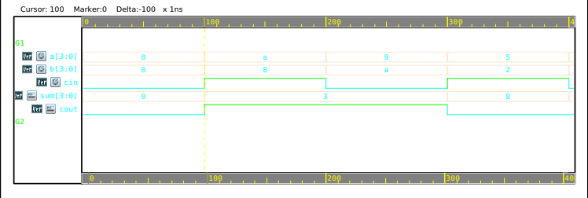
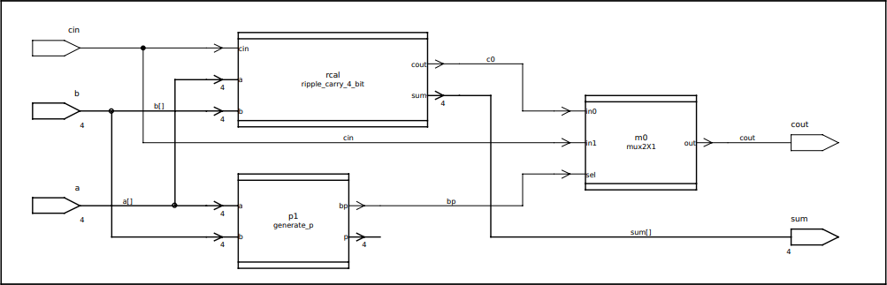

# Simulation Results: 4-bit Carry Skip Adder

> Topic 07: Carry Skip Adder · Author: Anushka Gope

The images below were extracted from the original lab documents. They are genuine captures, not regenerated.

### `waveform.png`

Waveform supplied in the source (signal names differ from the supplied testbench).

### `schematic.png`

Schematic supplied in the source (module names differ from the supplied code).

## What the images show

Waveform supplied in the source, with values read from the image:

| A | B | Cin | Sum | Cout |
|---|---|---|---|---|
| 0 | 0 | 0 | 0 | 0 |
| a | 8 | 1 | 3 | 1 |
| 9 | a | 0 | 3 | 1 |
| 5 | 2 | 1 | 8 | 0 |

Values are hexadecimal. They are consistent with 4-bit addition. The waveform uses lower-case signal names (`a`, `b`, `cin`, `sum`, `cout`) and a stimulus that does not match the supplied testbench, so it was evidently produced by a different testbench.

Area, delay and power reports are in [`Synthesis-Reports/`](../Synthesis-Reports/). Key figures from the carry skip report: 14 I/Os, 25 BELS (10 AND2, 1 AND4, 1 INV, 5 OR2, 8 XOR2), 14 I/O buffers, estimated power 37.800 uW at 1.80 V, and a longest pad-to-pad delay of 13.400 ns.

**Provenance of the reports and images.** The waveform, schematic and reports come from the lab's own modules, which are not the files added later. The added `rca.v` and `mux_2to1.v` are new and are not claimed to be identical to the modules behind those images and reports.

**Corrected testbench (`carry_skip_adder_tb.v`).** It applies all 16 x 16 x 2 = 512 combinations of A, B and Cin and prints a `FAIL` line whenever `{Cout, Sum}` differs from `A + B + Cin`. It prints nothing for a passing case. Not simulated: no simulator was available, so no pass/fail result is claimed for the added files.

## Not provided in the source

- `simulation-output.png` (console / transcript output): the source documents contain no console captures, so this file has intentionally not been created.

## Notes

- The supplied schematic shows different module names (`ripple_carry_4_bit`, `generate_p`, `mux2X1`) from the code.
- The supplied waveform uses lower-case signal names and a stimulus that does not match either testbench.
- The post-lab "Expected Comparison" table does not agree with the actual reports (for example 40 and 42 BELs versus 100 and 25). See the post-lab files in `Synthesis-Reports/`.
- The corrected top module has the same ports and instances as the original. A token comparison shows three differences only: grouped input declaration (`input [3:0] A, B`), `&P` instead of `P[0] & P[1] & P[2] & P[3]`, and `endmodule` instead of `Endmodule`. The originals are kept in `Original-Source/`.
