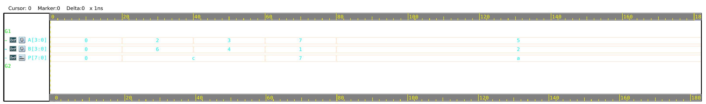

# 4-bit Braun Array Multiplier

> **Topic 08: 4-bit Braun Array Multiplier** · Author: Anushka Gope

> **Original source: pending. Reference implementation added.** The original Braun array multiplier code from the lab was not available. The Verilog in this folder was newly written to fill that gap. It is **not** my original laboratory code, it is behavioural rather than a structural full-adder array, and it has not been simulated. The waveform shown comes from the original lab work, not from this reference code.

## Purpose

4-bit multiplier for two unsigned numbers with an 8-bit product, filed under the Braun array multiplier topic. **The code in this folder is a newly written reference implementation, not the original laboratory code.**

## Working Principle

Four partial-product rows are formed as `A & {4{B[j]}}`, shifted into position and summed with the `+` operator. This computes the same function as a Braun array multiplier (unsigned 4 x 4 -> 8 bits), but it is written behaviourally. It is **not** a gate-level array of full adders with diagonal carries, so it should not be read as a structural model of the original array.

## Interface

### Inputs

| Port | Width | Description |
|---|---|---|
| `A` | 4 | Multiplicand (unsigned) |
| `B` | 4 | Multiplier (unsigned) |

### Outputs

| Port | Width | Description |
|---|---|---|
| `P` | 8 | Product |

## Source Files

**Origin key.** *Original*: extracted from the lab documents (formatting only). *Corrected (new)* and *Added (new)*: newly prepared files merged in later; they are not recovered originals and have not been simulated. *Added (reference implementation)*: newly written to stand in for missing source.

| Role | File | Top module | Origin | Note |
|---|---|---|---|---|
| Design | [`braun_array_multiplier_4bit.v`](braun_array_multiplier_4bit.v) | `braun_array_multiplier_4bit` | Added (reference implementation) | Newly written; NOT the original lab code |
| Testbench | [`braun_array_multiplier_4bit_tb.v`](braun_array_multiplier_4bit_tb.v) | `braun_array_multiplier_4bit_tb` | Added (reference implementation) | Exhaustive 16 x 16 comparison; not simulated |

## Simulation Results

**Waveform supplied in the source (header with host/path information cropped out)**



**Original waveform.** A waveform from the original lab work was supplied; the implementation behind it was not. Signals `A[3:0]`, `B[3:0]`, `P[7:0]`; values (hexadecimal) read from the image:

| A | B | P | Check |
|---|---|---|---|
| 0 | 0 | 0 | 0 x 0 = 0 |
| 2 | 6 | c | 2 x 6 = 12 |
| 3 | 4 | c | 3 x 4 = 12 |
| 7 | 1 | 7 | 7 x 1 = 7 |
| 5 | 2 | a | 5 x 2 = 10 |

This waveform was **not** produced by the reference implementation in this folder and is not evidence that it works.

**Reference testbench (`braun_array_multiplier_4bit_tb.v`).** It applies all 16 x 16 = 256 combinations and prints a `FAIL` line whenever `P` differs from `A x B`. It prints nothing for a passing case. Not simulated: no simulator was available, so no pass/fail result is claimed for the added files.

See [`Simulation-Results/README.md`](Simulation-Results/README.md) for details.

## Known Issues and Resolutions

Original code is preserved exactly (in `Original-Source/` where a file was replaced). Problems are documented rather than silently corrected.

- **Original Braun array source: pending.** The original lab Verilog (design, testbench, reports) was never supplied. The files in this folder are a newly written reference implementation added to fill the gap.

All issues are collected in [`Known-Issues.md`](../../Known-Issues.md).

## Running the Simulation

**Compile status (static review):** Static port/name check of `braun_array_multiplier_4bit.v` with its testbench: no problems found.

```bash
# Example with Icarus Verilog (indicative; not executed while preparing this repository)
iverilog -o sim braun_array_multiplier_4bit.v braun_array_multiplier_4bit_tb.v
vvp sim
```

The original results were produced with the tools used in the lab (ModelSim-style waveform windows and Synopsys / Xilinx report formats appear in the source). No simulation was re-run while preparing this portfolio.
