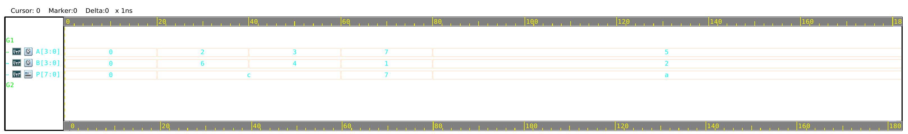

# Simulation Results: 4-bit Braun Array Multiplier

> Topic 08: 4-bit Braun Array Multiplier · Author: Anushka Gope

The images below were extracted from the original lab documents. They are genuine captures, not regenerated.

### `waveform.png`

Waveform supplied in the source (header with host/path information cropped out).

## What the images show

**Original waveform.** A waveform from the original lab work was supplied; the implementation behind it was not. Signals `A[3:0]`, `B[3:0]`, `P[7:0]`; values (hexadecimal) read from the image:

| A | B | P | Check |
|---|---|---|---|
| 0 | 0 | 0 | 0 x 0 = 0 |
| 2 | 6 | c | 2 x 6 = 12 |
| 3 | 4 | c | 3 x 4 = 12 |
| 7 | 1 | 7 | 7 x 1 = 7 |
| 5 | 2 | a | 5 x 2 = 10 |

This waveform was **not** produced by the reference implementation in this folder and is not evidence that it works.

**Reference testbench (`braun_array_multiplier_4bit_tb.v`).** It applies all 16 x 16 = 256 combinations and prints a `FAIL` line whenever `P` differs from `A x B`. It prints nothing for a passing case. Not simulated: no simulator was available, so no pass/fail result is claimed for the added files.

## Not provided in the source

- `simulation-output.png` (console / transcript output): the source documents contain no console captures, so this file has intentionally not been created.

## Notes

- **Original Braun array source: pending.** The original lab Verilog (design, testbench, reports) was never supplied. The files in this folder are a newly written reference implementation added to fill the gap.
