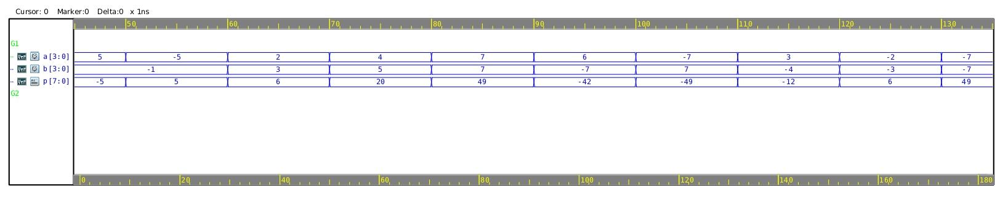
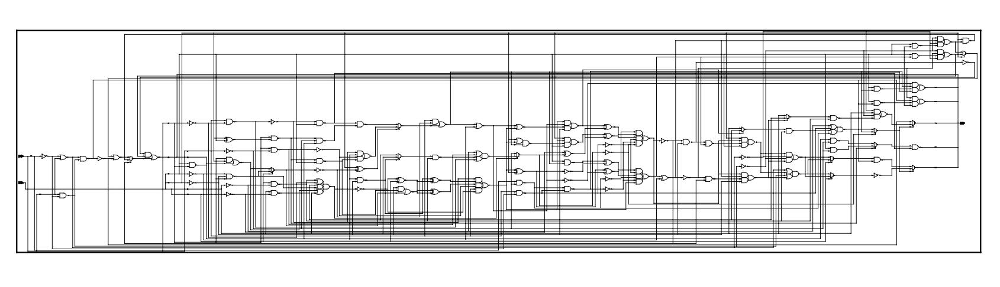
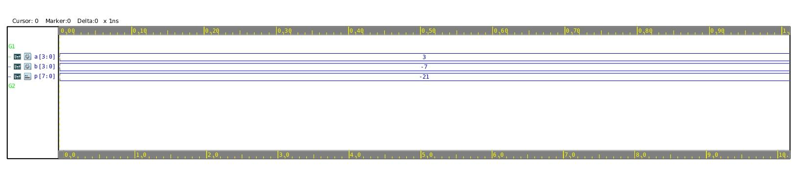

# 4-bit Booth Multiplier

> **Topic 09: 4-bit Booth Multiplier** · Author: Anushka Gope

## Purpose

Multiplies two 4-bit signed (two's-complement) numbers into an 8-bit signed product using Booth's algorithm.

## Working Principle

Radix-2 Booth multiplication written behaviourally in an `always @(*)` block. The accumulator `ACC` starts at 0, the multiplier `B` is loaded into `Q`, and `Q_1` is 0. For four iterations the pair `{Q[0], Q_1}` selects the action: `01` adds the multiplicand `M`, `10` subtracts it, and `00`/`11` do nothing; then `{ACC, Q, Q_1}` is arithmetically shifted right. The product is `{ACC[3:0], Q}`. The corrected testbench (`booth_multiplier_tb.v`) applies all 16 x 16 = 256 signed combinations from -8 to 7 and prints a `FAIL` line whenever `P` differs from `A x B`. The original testbenches (selected vectors, and the post-lab 3 x -7 case) are kept in `Original-Source/`.

## Interface

### Inputs

| Port | Width | Description |
|---|---|---|
| `A` | 4 | Signed multiplicand |
| `B` | 4 | Signed multiplier |

### Outputs

| Port | Width | Description |
|---|---|---|
| `P` | 8 | Signed product (reg) |

## Source Files

**Origin key.** *Original*: extracted from the lab documents (formatting only). *Corrected (new)* and *Added (new)*: newly prepared files merged in later; they are not recovered originals and have not been simulated. *Added (reference implementation)*: newly written to stand in for missing source.

| Role | File | Top module | Origin | Note |
|---|---|---|---|---|
| Design | [`booth_multiplier.v`](booth_multiplier.v) | `booth_v` | Original | Unchanged |
| Testbench | [`booth_multiplier_tb.v`](booth_multiplier_tb.v) | `booth_multiplier_tb` | Corrected (new) | Instantiates `booth_v(A, B, P)`; exhaustive 16 x 16; not simulated |

**Original files, kept unchanged** in [`Original-Source/`](Original-Source/) (see its [README](Original-Source/README.md)):

| Role | File | Top module | Why it is not the main file |
|---|---|---|---|
| Testbench | [`Original-Source/booth_multiplier_tb.v`](Original-Source/booth_multiplier_tb.v) | `booth _tb` | Module name contains a space; instantiates `booth` instead of `booth_v` |
| Testbench (post-lab) | [`Original-Source/booth_postlab_tb.v`](Original-Source/booth_postlab_tb.v) | `booth_tb` | Includes `booth.v` and instantiates `booth` with lower-case ports |

**Synthesis / tool reports**

- [`Synthesis-Reports/main-power-report.txt`](Synthesis-Reports/main-power-report.txt): Power report from the main lab (design label reads `full_adder`)
- [`Synthesis-Reports/main-area-report.txt`](Synthesis-Reports/main-area-report.txt): Area report from the main lab (design label reads `full_adder`)
- [`Synthesis-Reports/postlab-area-report.txt`](Synthesis-Reports/postlab-area-report.txt): Post-lab area report (`Design : booth`)

## Simulation Results

**Waveform of the main testbench (lower-case signal names a, b, p)**



**Schematic supplied in the source**



**Post-lab waveform: 3 x -7**



**Waveform from the lab's own testbench run** (decimal, signed). Values read from the image, which covers the vectors from A = 5, B = -1 onward to A = -7, B = -7:

| A | B | P |
|---|---|---|
| 5 | -1 | -5 |
| -5 | -1 | 5 |
| 2 | 3 | 6 |
| 4 | 5 | 20 |
| 7 | 7 | 49 |
| 6 | -7 | -42 |
| -7 | 7 | -49 |
| 3 | -4 | -12 |
| -2 | -3 | 6 |
| -7 | -7 | 49 |

The image does not show the earlier zero vectors or the later -8 boundary vectors.

**Post-lab (Multiply 3 x -7):** the supplied waveform shows `a = 3`, `b = -7`, `p = -21`.

**Synthesis reports** (Synopsys Design Compiler style output) are in [`Synthesis-Reports/`](Synthesis-Reports/). Figures from the main reports: total dynamic power 22.2518 uW, cell leakage power 288.5607 nW, total power 22.5404 uW; 115 cells, total area 317.368257. Post-lab area report: 110 cells, total area 301.605979.

**Provenance.** The waveforms and reports come from the lab's own earlier testbench (lower-case signal names `a`, `b`, `p`), not from the corrected testbench. The corrected testbench includes the 3 x -7 case among its 256 combinations. Not simulated: no simulator was available, so no pass/fail result is claimed for the added files.

See [`Simulation-Results/README.md`](Simulation-Results/README.md) for details.

## Known Issues and Resolutions

Original code is preserved exactly (in `Original-Source/` where a file was replaced). Problems are documented rather than silently corrected.

**Resolved by the added / corrected files**

- Testbench connections: the corrected testbench has a legal module name (`booth_multiplier_tb`) and instantiates `booth_v` with ports `A`, `B`, `P`. The original testbenches are kept in `Original-Source/`.
- Include and instance mismatch of the post-lab testbench: it is no longer part of the compile set (original kept in `Original-Source/`). The new exhaustive testbench covers 3 x -7.
- The `$fsdbDumpvars` call is not used by the corrected testbench.

**Still open or worth knowing**

- The post-lab testbench was not corrected separately; its original is preserved in `Original-Source/` and does not compile as supplied (`include "booth.v"`, instance `booth`).
- The waveform images use lower-case names (`a`, `b`, `p`), so they came from a testbench that is not among the supplied files.
- The first two reports are headed `Design : full_adder`, while the design synthesised has 16 ports (4 + 4 + 8), consistent with the Booth multiplier. The heading appears to be stale and was left as supplied.

All issues are collected in [`Known-Issues.md`](../../Known-Issues.md).

## Running the Simulation

**Compile status (static review):** Static port/name check of `booth_multiplier.v` with `booth_multiplier_tb.v`: no problems found.

```bash
# Example with Icarus Verilog (indicative; not executed while preparing this repository)
iverilog -o sim booth_multiplier.v booth_multiplier_tb.v
vvp sim
```

Do not mix the files in `Original-Source/` with the main files: several of them define the same module names.

The original results were produced with the tools used in the lab (ModelSim-style waveform windows and Synopsys / Xilinx report formats appear in the source). No simulation was re-run while preparing this portfolio.
