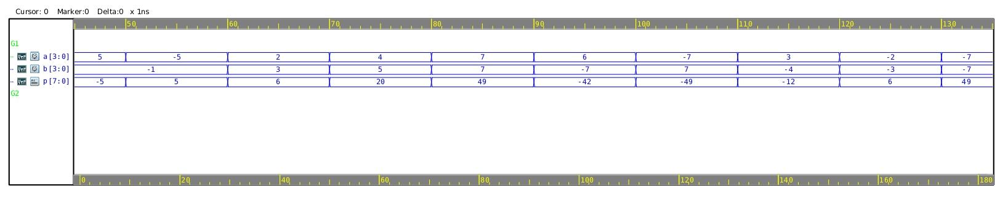
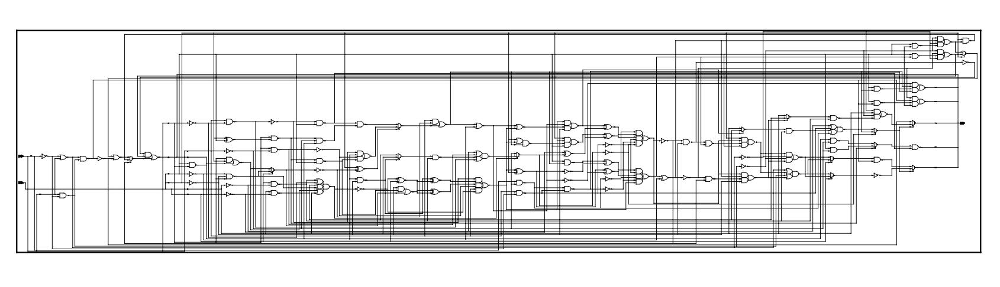
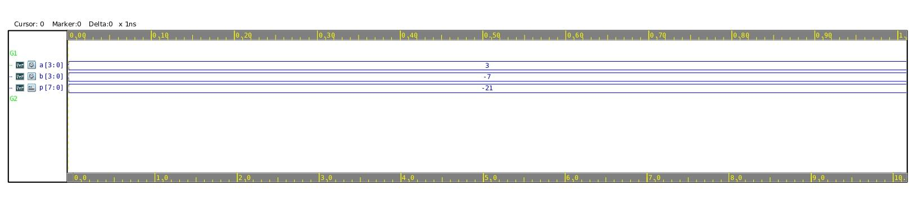

# Simulation Results: 4-bit Booth Multiplier

> Topic 09: 4-bit Booth Multiplier · Author: Anushka Gope

The images below were extracted from the original lab documents. They are genuine captures, not regenerated.

### `waveform.png`

Waveform of the main testbench (lower-case signal names a, b, p).

### `schematic.png`

Schematic supplied in the source.

### `waveform-postlab-3x-7.png`

Post-lab waveform: 3 x -7.

## What the images show

**Waveform from the lab's own testbench run** (decimal, signed). Values read from the image, which covers the vectors from A = 5, B = -1 onward to A = -7, B = -7:

| A | B | P |
|---|---|---|
| 5 | -1 | -5 |
| -5 | -1 | 5 |
| 2 | 3 | 6 |
| 4 | 5 | 20 |
| 7 | 7 | 49 |
| 6 | -7 | -42 |
| -7 | 7 | -49 |
| 3 | -4 | -12 |
| -2 | -3 | 6 |
| -7 | -7 | 49 |

The image does not show the earlier zero vectors or the later -8 boundary vectors.

**Post-lab (Multiply 3 x -7):** the supplied waveform shows `a = 3`, `b = -7`, `p = -21`.

**Synthesis reports** (Synopsys Design Compiler style output) are in [`Synthesis-Reports/`](../Synthesis-Reports/). Figures from the main reports: total dynamic power 22.2518 uW, cell leakage power 288.5607 nW, total power 22.5404 uW; 115 cells, total area 317.368257. Post-lab area report: 110 cells, total area 301.605979.

**Provenance.** The waveforms and reports come from the lab's own earlier testbench (lower-case signal names `a`, `b`, `p`), not from the corrected testbench. The corrected testbench includes the 3 x -7 case among its 256 combinations. Not simulated: no simulator was available, so no pass/fail result is claimed for the added files.

## Not provided in the source

- `simulation-output.png` (console / transcript output): the source documents contain no console captures, so this file has intentionally not been created.

## Notes

- The post-lab testbench was not corrected separately; its original is preserved in `Original-Source/` and does not compile as supplied (`include "booth.v"`, instance `booth`).
- The waveform images use lower-case names (`a`, `b`, `p`), so they came from a testbench that is not among the supplied files.
- The first two reports are headed `Design : full_adder`, while the design synthesised has 16 ports (4 + 4 + 8), consistent with the Booth multiplier. The heading appears to be stale and was left as supplied.
