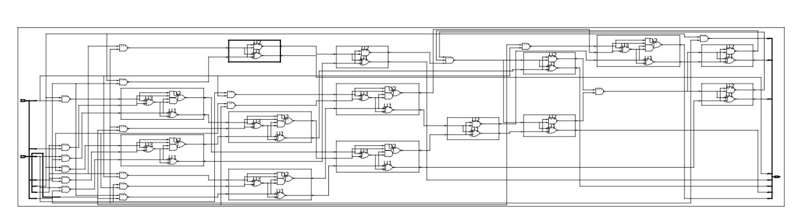

# 4-bit Wallace Tree Multiplier

> **Topic 10: 4-bit Wallace Tree Multiplier** · Author: Anushka Gope

## Purpose

Multiplies two 4-bit unsigned numbers using a Wallace-tree style reduction of partial products.

## Working Principle

Sixteen AND gates generate the partial products `pp00`..`pp33`. These are compressed by a network of half and full adders (`HA1`, `FA1`..`FA7`, `HA2`) into two rows, and a final chain of half adders (`HA3`..`HA7`) produces product bits `p[2]`..`p[6]`; `p[0]` is `pp00` and `p[7]` is the last carry. Helper modules `full_adder` and `half_adder` are defined in the same file. The testbench applies eight (a, b) pairs, 20 ns apart.

## Interface

### Inputs

| Port | Width | Description |
|---|---|---|
| `a` | 4 | Multiplicand |
| `b` | 4 | Multiplier |

### Outputs

| Port | Width | Description |
|---|---|---|
| `p` | 8 | Product |

## Source Files

| Type | File | Top module | Origin |
|---|---|---|---|
| Design | [`wallace_4bit.v`](wallace_4bit.v) | `wallace` | Original |
| Testbench | [`wallace_4bit_tb.v`](wallace_4bit_tb.v) | `wallace_tb` | Original |

**Synthesis / tool reports**

- [`Synthesis-Reports/area-power-timing-reports.txt`](Synthesis-Reports/area-power-timing-reports.txt): Area, power and timing reports for `wallace`

## Simulation Results

**Waveform of `wallace_tb` (time unit 1 ps in this view)**


**Schematic supplied in the source**



Values (decimal) read from the waveform:

| a | b | p |
|---|---|---|
| 1 | 1 | 1 |
| 2 | 3 | 6 |
| 3 | 5 | 15 |
| 5 | 6 | 30 |
| 7 | 9 | 63 |
| 10 | 5 | 50 |
| 12 | 3 | 36 |
| 15 | 8 | 120 |

All eight products equal a x b.

Synthesis area, power and timing reports are in [`Synthesis-Reports/`](Synthesis-Reports/). Figures: 79 ports, 124 nets, 67 cells; total area 171.796473; total dynamic power 13.4787 uW, cell leakage 208.1095 nW, total 13.6868 uW; critical path from `a[2]` to `p[6]`, data arrival time 2.06.

See [`Simulation-Results/README.md`](Simulation-Results/README.md) for details.

## Known Issues and Resolutions

Original code is preserved exactly (in `Original-Source/` where a file was replaced). Problems are documented rather than silently corrected.

- By inspection, the nets `c10` and `c11` are each driven by several half-adder outputs (`c10` by `HA3`, `HA5` and `HA7`; `c11` by `HA4` and `HA6`) and also fed back into later half adders. The synthesis log reports "Timing loop detected" and disables timing arcs on `HA5/U2` and `HA7/U2`. The simulation screenshot nevertheless shows the expected products for the eight vectors. This structure should be reviewed; it was left unchanged.
- The testbench uses `$fsdbDumpvars`, a Synopsys/Verdi system task that is not available in every simulator.
- The waveform image is displayed in picoseconds, while the testbench timescale is 1 ns / 1 ps.

All issues are collected in [`Known-Issues.md`](../../Known-Issues.md).

## Running the Simulation

**Compile status (static review):** Compiles on its own by static reading, apart from the multiply-driven nets noted above.

```bash
# Example with Icarus Verilog (indicative; not executed while preparing this repository)
iverilog -o sim wallace_4bit.v wallace_4bit_tb.v
vvp sim
```

The original results were produced with the tools used in the lab (ModelSim-style waveform windows and Synopsys / Xilinx report formats appear in the source). No simulation was re-run while preparing this portfolio.
