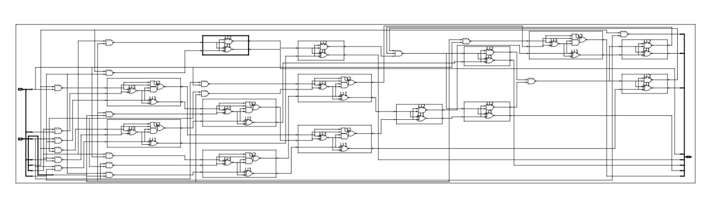

# Simulation Results: 4-bit Wallace Tree Multiplier

> Topic 10: 4-bit Wallace Tree Multiplier · Author: Anushka Gope

The images below were extracted from the original lab documents. They are genuine captures, not regenerated.

### `waveform.png`

Waveform of `wallace_tb` (time unit 1 ps in this view).

### `schematic.png`

Schematic supplied in the source.

## What the images show

Values (decimal) read from the waveform:

| a | b | p |
|---|---|---|
| 1 | 1 | 1 |
| 2 | 3 | 6 |
| 3 | 5 | 15 |
| 5 | 6 | 30 |
| 7 | 9 | 63 |
| 10 | 5 | 50 |
| 12 | 3 | 36 |
| 15 | 8 | 120 |

All eight products equal a x b.

Synthesis area, power and timing reports are in [`Synthesis-Reports/`](../Synthesis-Reports/). Figures: 79 ports, 124 nets, 67 cells; total area 171.796473; total dynamic power 13.4787 uW, cell leakage 208.1095 nW, total 13.6868 uW; critical path from `a[2]` to `p[6]`, data arrival time 2.06.

## Not provided in the source

- `simulation-output.png` (console / transcript output): the source documents contain no console captures, so this file has intentionally not been created.

## Notes

- By inspection, the nets `c10` and `c11` are each driven by several half-adder outputs (`c10` by `HA3`, `HA5` and `HA7`; `c11` by `HA4` and `HA6`) and also fed back into later half adders. The synthesis log reports "Timing loop detected" and disables timing arcs on `HA5/U2` and `HA7/U2`. The simulation screenshot nevertheless shows the expected products for the eight vectors. This structure should be reviewed; it was left unchanged.
- The testbench uses `$fsdbDumpvars`, a Synopsys/Verdi system task that is not available in every simulator.
- The waveform image is displayed in picoseconds, while the testbench timescale is 1 ns / 1 ps.
