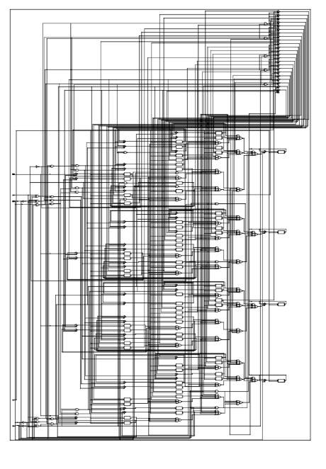

# 16 x 4 RAM

> **Topic 11: Memory Design: RAM and ROM** · Author: Anushka Gope

## Purpose

Implements a 16-word by 4-bit synchronous RAM with separate read and write enables.

## Working Principle

A 16-entry array of 4-bit registers is zeroed at start-up. On each rising clock edge, `WR = 1` stores `data` at `address`, and `RD = 1` loads the addressed word into the output register `out`. Because both use nonblocking assignments, a simultaneous read and write to the same address returns the old value. The testbench writes 5 to location 2 and 9 to location 3, then reads both back. The module is now called `ram_16x4`; the original was named `full_adder` (see `Original-Source/`).

## Interface

### Inputs

| Port | Width | Description |
|---|---|---|
| `clk` | 1 | Clock |
| `address` | 4 | Word address |
| `data` | 4 | Write data |
| `RD` | 1 | Read enable |
| `WR` | 1 | Write enable |

### Outputs

| Port | Width | Description |
|---|---|---|
| `out` | 4 | Read data (reg) |

## Source Files

**Origin key.** *Original*: extracted from the lab documents (formatting only). *Corrected (new)* and *Added (new)*: newly prepared files merged in later; they are not recovered originals and have not been simulated. *Added (reference implementation)*: newly written to stand in for missing source.

| Role | File | Top module | Origin | Note |
|---|---|---|---|---|
| Design | [`ram_16x4.v`](ram_16x4.v) | `ram_16x4` | Corrected (new) | Same behaviour as the original; module renamed from `full_adder` |
| Testbench | [`ram_16x4_tb.v`](ram_16x4_tb.v) | `ram_tb` | Corrected (new) | No include file and no `$fsdbDumpvars`; stimulus only; not simulated |

**Original files, kept unchanged** in [`Original-Source/`](Original-Source/) (see its [README](Original-Source/README.md)):

| Role | File | Top module | Why it is not the main file |
|---|---|---|---|
| Design | [`Original-Source/ram_16x4.v`](Original-Source/ram_16x4.v) | `full_adder` | Module is named `full_adder` |
| Testbench | [`Original-Source/ram_16x4_tb.v`](Original-Source/ram_16x4_tb.v) | `ram_tb` | Includes `full_adder_rtl.v`; uses `$fsdbDumpvars` |

## Simulation Results

**Waveform of `ram_tb` (matched by signal content; the source placed it under the ROM section)**


**Schematic supplied in the source**



The waveform shows `clk`, `address`, `data`, `RD`, `WR` and `out`: 5 is written to address 2 and 9 to address 3 while `WR` is high, then `out` shows 5 followed by 9 when `RD` is high and the addresses are read back. The `$display` console output was not supplied.

**Added testbench.** `ram_16x4_tb.v` performs the same write-then-read sequence (5 to location 2, 9 to location 3, read both back). It is stimulus only: no `$display`, no checks. The supplied waveform was captured from the lab's own earlier testbench. The new testbench has the same intent but different timing, so the waveform is not claimed to be its output. Not simulated: no simulator was available, so no pass/fail result is claimed for the added files.

See [`Simulation-Results/README.md`](Simulation-Results/README.md) for details.

## Known Issues and Resolutions

Original code is preserved exactly (in `Original-Source/` where a file was replaced). Problems are documented rather than silently corrected.

**Resolved by the added / corrected files**

- Module name: the RAM is now `ram_16x4` (original: `full_adder`). Behaviour is the same (checked by reading both).
- Include mismatch: the new testbench does not `include` any file and does not call `$fsdbDumpvars`.

**Still open or worth knowing**

- In the source, the RAM and ROM waveform images were placed under each other's sections. They were matched here by signal content.

All issues are collected in [`Known-Issues.md`](../../Known-Issues.md).

## Running the Simulation

**Compile status (static review):** Static port/name check of `ram_16x4.v` with `ram_16x4_tb.v`: no problems found.

```bash
# Example with Icarus Verilog (indicative; not executed while preparing this repository)
iverilog -o sim ram_16x4.v ram_16x4_tb.v
vvp sim
```

Do not mix the files in `Original-Source/` with the main files: several of them define the same module names.

The original results were produced with the tools used in the lab (ModelSim-style waveform windows and Synopsys / Xilinx report formats appear in the source). No simulation was re-run while preparing this portfolio.
