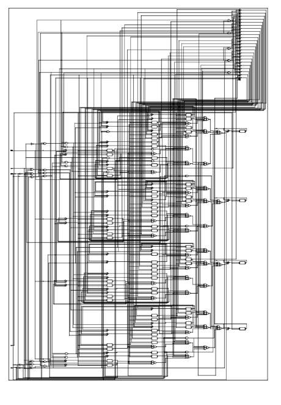

# Simulation Results: 16 x 4 RAM

> Topic 11: Memory Design: RAM and ROM · Author: Anushka Gope

The images below were extracted from the original lab documents. They are genuine captures, not regenerated.

### `waveform.png`

Waveform of `ram_tb` (matched by signal content; the source placed it under the ROM section).

### `schematic.png`

Schematic supplied in the source.

## What the images show

The waveform shows `clk`, `address`, `data`, `RD`, `WR` and `out`: 5 is written to address 2 and 9 to address 3 while `WR` is high, then `out` shows 5 followed by 9 when `RD` is high and the addresses are read back. The `$display` console output was not supplied.

**Added testbench.** `ram_16x4_tb.v` performs the same write-then-read sequence (5 to location 2, 9 to location 3, read both back). It is stimulus only: no `$display`, no checks. The supplied waveform was captured from the lab's own earlier testbench. The new testbench has the same intent but different timing, so the waveform is not claimed to be its output. Not simulated: no simulator was available, so no pass/fail result is claimed for the added files.

## Not provided in the source

- `simulation-output.png` (console / transcript output): the source documents contain no console captures, so this file has intentionally not been created.

## Notes

- In the source, the RAM and ROM waveform images were placed under each other's sections. They were matched here by signal content.
