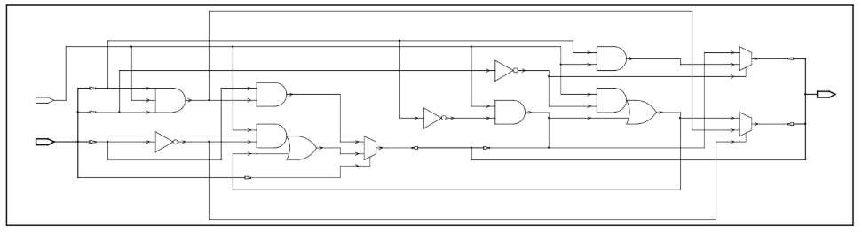

# 16 x 4 ROM

> **Topic 11: Memory Design: RAM and ROM** · Author: Anushka Gope

## Purpose

Implements a 16-word by 4-bit ROM that returns a fixed value for each address.

## Working Principle

Combinational `always @(*)` block. When `RD = 1` the output is `address + 1` (4-bit, so address 15 gives 0); when `RD = 0` the output is 0. The original used a 16-entry `case` table with exactly this mapping (checked entry by entry) and `default` 0, and its module was named `full_adder`. The testbench sweeps all 16 addresses and then deasserts `RD`.

## Interface

### Inputs

| Port | Width | Description |
|---|---|---|
| `address` | 4 | Word address |
| `RD` | 1 | Read enable |

### Outputs

| Port | Width | Description |
|---|---|---|
| `out` | 4 | Stored value (reg) |

## Source Files

**Origin key.** *Original*: extracted from the lab documents (formatting only). *Corrected (new)* and *Added (new)*: newly prepared files merged in later; they are not recovered originals and have not been simulated. *Added (reference implementation)*: newly written to stand in for missing source.

| Role | File | Top module | Origin | Note |
|---|---|---|---|---|
| Design | [`rom_16x4.v`](rom_16x4.v) | `rom_16x4` | Corrected (new) | Same behaviour as the original table (address + 1); module renamed |
| Testbench | [`rom_16x4_tb.v`](rom_16x4_tb.v) | `rom_tb` | Corrected (new) | No include file and no `$fsdbDumpvars`; stimulus only; not simulated |

**Original files, kept unchanged** in [`Original-Source/`](Original-Source/) (see its [README](Original-Source/README.md)):

| Role | File | Top module | Why it is not the main file |
|---|---|---|---|
| Design | [`Original-Source/rom_16x4.v`](Original-Source/rom_16x4.v) | `full_adder` | Module is named `full_adder` |
| Testbench | [`Original-Source/rom_16x4_tb.v`](Original-Source/rom_16x4_tb.v) | `rom_tb` | Includes `full_adder_rtl.v`; uses `$fsdbDumpvars` |

## Simulation Results

**Waveform of `rom_tb` (matched by signal content; the source placed it under the RAM code)**


**Schematic supplied in the source**



The waveform shows `address[3:0]`, `RD` and `out[3:0]` while the address is swept through 0 to F, with `out` returning to 0 when `RD` is low.

**Added testbench.** `rom_16x4_tb.v` sweeps the 16 addresses (5 ns each) with `RD` high, then deasserts `RD`. It is stimulus only. The supplied waveform was captured from the lab's own earlier testbench. The new testbench has the same intent but different timing, so the waveform is not claimed to be its output. Not simulated: no simulator was available, so no pass/fail result is claimed for the added files.

See [`Simulation-Results/README.md`](Simulation-Results/README.md) for details.

## Known Issues and Resolutions

Original code is preserved exactly (in `Original-Source/` where a file was replaced). Problems are documented rather than silently corrected.

**Resolved by the added / corrected files**

- Module name: the ROM is now `rom_16x4` (original: `full_adder`). The mapping equals the original table.
- Include mismatch: the new testbench does not `include` any file and does not call `$fsdbDumpvars`.

**Still open or worth knowing**

- The waveform image was placed under the RAM code in the source; it was matched here by signal content.
- The new ROM computes `address + 1` instead of listing a table, so it is not a stored-constant table like the original.

All issues are collected in [`Known-Issues.md`](../../Known-Issues.md).

## Running the Simulation

**Compile status (static review):** Static port/name check of `rom_16x4.v` with `rom_16x4_tb.v`: no problems found.

```bash
# Example with Icarus Verilog (indicative; not executed while preparing this repository)
iverilog -o sim rom_16x4.v rom_16x4_tb.v
vvp sim
```

Do not mix the files in `Original-Source/` with the main files: several of them define the same module names.

The original results were produced with the tools used in the lab (ModelSim-style waveform windows and Synopsys / Xilinx report formats appear in the source). No simulation was re-run while preparing this portfolio.
