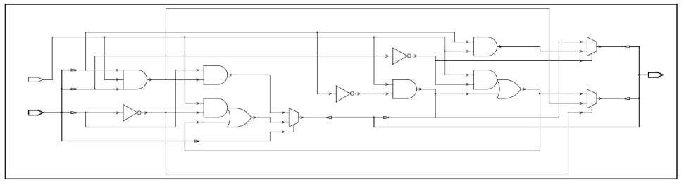

# Simulation Results: 16 x 4 ROM

> Topic 11: Memory Design: RAM and ROM · Author: Anushka Gope

The images below were extracted from the original lab documents. They are genuine captures, not regenerated.

### `waveform.png`

Waveform of `rom_tb` (matched by signal content; the source placed it under the RAM code).

### `schematic.png`

Schematic supplied in the source.

## What the images show

The waveform shows `address[3:0]`, `RD` and `out[3:0]` while the address is swept through 0 to F, with `out` returning to 0 when `RD` is low.

**Added testbench.** `rom_16x4_tb.v` sweeps the 16 addresses (5 ns each) with `RD` high, then deasserts `RD`. It is stimulus only. The supplied waveform was captured from the lab's own earlier testbench. The new testbench has the same intent but different timing, so the waveform is not claimed to be its output. Not simulated: no simulator was available, so no pass/fail result is claimed for the added files.

## Not provided in the source

- `simulation-output.png` (console / transcript output): the source documents contain no console captures, so this file has intentionally not been created.

## Notes

- The waveform image was placed under the RAM code in the source; it was matched here by signal content.
- The new ROM computes `address + 1` instead of listing a table, so it is not a stored-constant table like the original.
