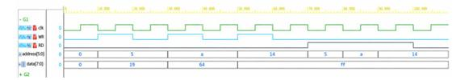
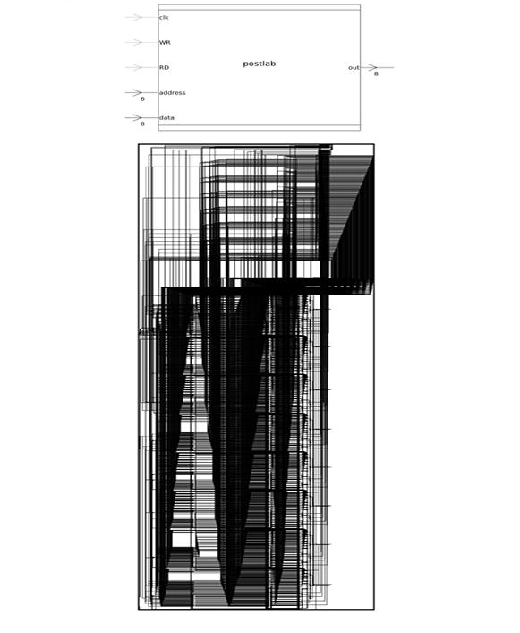

# 64 x 8 RAM (post-lab)

> **Topic 11: Memory Design: RAM and ROM** · Author: Anushka Gope

## Purpose

Post-lab exercise: a 64-word by 8-bit synchronous RAM.

## Working Principle

Same structure as the 16 x 4 RAM with a 6-bit address and 8-bit data: a 64-entry memory zeroed at start-up, synchronous write when `WR = 1`, synchronous read into `out` when `RD = 1`. The testbench uses a 10 ns clock, writes 25 to address 5, 100 to address 10 and 255 to address 20, then reads the three addresses back. The module is now called `ram_64x8`; the original was named `full_adder` (see `Original-Source/`).

## Interface

### Inputs

| Port | Width | Description |
|---|---|---|
| `clk` | 1 | Clock |
| `WR` | 1 | Write enable |
| `RD` | 1 | Read enable |
| `address` | 6 | Word address |
| `data` | 8 | Write data |

### Outputs

| Port | Width | Description |
|---|---|---|
| `out` | 8 | Read data (reg) |

## Source Files

**Origin key.** *Original*: extracted from the lab documents (formatting only). *Corrected (new)* and *Added (new)*: newly prepared files merged in later; they are not recovered originals and have not been simulated. *Added (reference implementation)*: newly written to stand in for missing source.

| Role | File | Top module | Origin | Note |
|---|---|---|---|---|
| Design | [`ram_64x8.v`](ram_64x8.v) | `ram_64x8` | Corrected (new) | Same behaviour as the original; module renamed from `full_adder` |
| Testbench | [`ram_64x8_tb.v`](ram_64x8_tb.v) | `ram64_tb` | Corrected (new) | No include file and no `$fsdbDumpvars`; stimulus only; not simulated |

**Original files, kept unchanged** in [`Original-Source/`](Original-Source/) (see its [README](Original-Source/README.md)):

| Role | File | Top module | Why it is not the main file |
|---|---|---|---|
| Design | [`Original-Source/ram_64x8.v`](Original-Source/ram_64x8.v) | `full_adder` | Module is named `full_adder` |
| Testbench | [`Original-Source/ram_64x8_tb.v`](Original-Source/ram_64x8_tb.v) | `ramm_tb` | Includes `full_adder_rtl.v`; uses `$fsdbDumpvars` |

## Simulation Results

**Waveform cropped from the combined post-lab figure**



**Block diagram and schematic cropped from the combined post-lab figure**



The waveform (cropped from the combined post-lab figure) shows `clk`, `WR`, `RD`, `address` (0, 5, a, 14 and then 5, a, 14 in hexadecimal, i.e. 5, 10, 20) and `data` (19, 64, ff hexadecimal, i.e. 25, 100, 255). The `out` bus is not included in the captured waveform, and the `$display` console output was not supplied.

**Added testbench.** `ram_64x8_tb.v` writes 25, 100 and 255 to addresses 5, 10 and 20, then reads them back. It is stimulus only. The supplied waveform was captured from the lab's own earlier testbench. The new testbench has the same intent but different timing, so the waveform is not claimed to be its output. Not simulated: no simulator was available, so no pass/fail result is claimed for the added files.

See [`Simulation-Results/README.md`](Simulation-Results/README.md) for details.

## Known Issues and Resolutions

Original code is preserved exactly (in `Original-Source/` where a file was replaced). Problems are documented rather than silently corrected.

**Resolved by the added / corrected files**

- Module name: the RAM is now `ram_64x8` (original: `full_adder`). Behaviour is the same (checked by reading both).
- Include mismatch: the new testbench does not `include` any file and does not call `$fsdbDumpvars`.

**Still open or worth knowing**

- The `out` bus is not included in the supplied post-lab waveform.

All issues are collected in [`Known-Issues.md`](../../Known-Issues.md).

## Running the Simulation

**Compile status (static review):** Static port/name check of `ram_64x8.v` with `ram_64x8_tb.v`: no problems found.

```bash
# Example with Icarus Verilog (indicative; not executed while preparing this repository)
iverilog -o sim ram_64x8.v ram_64x8_tb.v
vvp sim
```

Do not mix the files in `Original-Source/` with the main files: several of them define the same module names.

The original results were produced with the tools used in the lab (ModelSim-style waveform windows and Synopsys / Xilinx report formats appear in the source). No simulation was re-run while preparing this portfolio.
