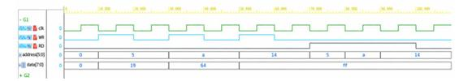
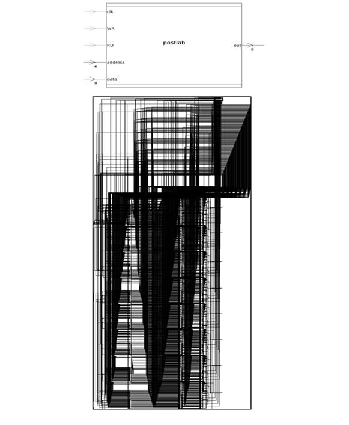

# Simulation Results: 64 x 8 RAM (post-lab)

> Topic 11: Memory Design: RAM and ROM · Author: Anushka Gope

The images below were extracted from the original lab documents. They are genuine captures, not regenerated.

### `waveform.png`

Waveform cropped from the combined post-lab figure.

### `schematic.png`

Block diagram and schematic cropped from the combined post-lab figure.

## What the images show

The waveform (cropped from the combined post-lab figure) shows `clk`, `WR`, `RD`, `address` (0, 5, a, 14 and then 5, a, 14 in hexadecimal, i.e. 5, 10, 20) and `data` (19, 64, ff hexadecimal, i.e. 25, 100, 255). The `out` bus is not included in the captured waveform, and the `$display` console output was not supplied.

**Added testbench.** `ram_64x8_tb.v` writes 25, 100 and 255 to addresses 5, 10 and 20, then reads them back. It is stimulus only. The supplied waveform was captured from the lab's own earlier testbench. The new testbench has the same intent but different timing, so the waveform is not claimed to be its output. Not simulated: no simulator was available, so no pass/fail result is claimed for the added files.

## Not provided in the source

- `simulation-output.png` (console / transcript output): the source documents contain no console captures, so this file has intentionally not been created.

## Notes

- The `out` bus is not included in the supplied post-lab waveform.
